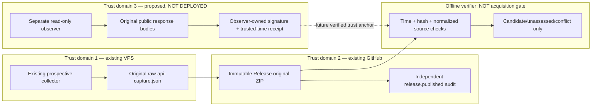

# Funding R2 independent pre-entry witness — detailed design (offline prototype)

Status: **DRAFT / NOT DEPLOYED / NO EVIDENCE STANDARD APPROVAL**  
Updated: 2026-10-25  
Tracking: [Issue #85](https://github.com/pkking/future-opportunity/issues/85), [parent research](../research/okx-funding-asof-source-provenance-feasibility.md)  
Safety: existing V0 paper-only baseline and ADR-0008 remain binding.

## Scope and direction

User feedback on 2026-10-25 explicitly rejected **Option A as the preferred future solution** for the missing independent source. Accordingly, **Option B** (independent pre-entry witness) is the engineering design direction. This authorizes **design and fully offline test preparation only**; it does **not** authorize deploying an external observer, trusting any timestamp/signature, changing the historical source-admission standard, or executing trades. Existing R1 GitHub immutable Releases may remain operational as **reference data**, not the solution to independent OKX publication provenance.

The missing claim is: could a separately controlled observer have obtained the relevant public OKX settled Funding and completed UTC daily spot features **before UTC 00:15 entry**, independently of the current VPS? A future R2 witness could corroborate that claim, but would **not prove the exchange's first-publication time or an OKX signature**.

The [official OKX V5 guide](https://www.okx.com/docs-v5/en/) describes public `GET /api/v5/public/funding-rate-history` (`fundingTime`, `realizedRate`) and `GET /api/v5/market/history-candles` (`bar=1Dutc`, `confirm`), while the Market Data cache behavior may be non-monotonic. Their published REST client request signature `OK-ACCESS-SIGN` is **not** an OKX-origin signature on the response. Do not infer authenticity from the event-time field.

## Trust boundaries: current, proposed and unimplemented



**Important:** the offline prototype currently accepts an **operator-supplied** R1 JSON file, not an authenticated immutable GitHub source-binding proof, and the R2 receipt is only *self-declared*. The diagram's `WS` is a future requirement, **not an implemented signing or timestamp service**. Consequently the prototype hard-codes `r1_source_custody_verified_here=false`, `observer_identity_attested=false` and `trusted_time_attested=false`, even for matching data.

A production-grade implementation would need separate administrative owners or independently attestable service identities, separate host/cloud/network and authentication keys not accessible from VPS, clock source with verifiable uncertainty, and a third-party witness/append-only anchor before the entry deadline. Same VPS or same owner using a second process/key is not independence.

## Contract and sequence

Research entry for UTC day `D` occurs at `D 00:15:00Z`. Proposed observer records in UTC:

1. `funding.started_at`, `funding.received_at`, raw exact-byte response and SHA-256 for `/api/v5/public/funding-rate-history?instId=BTC-USDT-SWAP&limit=400`.
2. `spot.started_at`, `spot.received_at`, raw exact-byte response and SHA-256 for `/api/v5/market/history-candles?instId=BTC-USDT&bar=1Dutc&limit=100`.
3. `witness_recorded_at` before entry, observer-owned identity, collector reference identity, distinct declared network, and bounded clock uncertainty. Future production requires *externally verifiable* operator signature and trusted time bound, not just those fields.
4. Independent artifact receipt should bind **both exact bodies**, query, instrument, timestamps, entry date, unique event/attempt identity, software digest, key ID, source URLs, trust anchor and append-only witness record ID. Replay must reject later replacement of any byte.

```mermaid
sequenceDiagram
    participant O as Independent observer (future)
    participant X as OKX public endpoints
    participant T as Independent receipt authority (future)
    participant G as R1 GitHub originals
    participant V as Offline review
    Note over O,V: Prospective UTC entry deadline D 00:15:00
    O->>X: GET settled Funding; record start/finish
    X-->>O: Raw original JSON + local observed receipt time
    O->>X: GET BTC-USDT 1Dutc; record start/finish
    X-->>O: Raw original JSON + local observed receipt time
    O-->>T: Future signed hashes and monotonic trusted-time claim
    Note over T: Must actually anchor before deadline
    G-->>V: Existing separately audited R1 original (future trust verification)
    T-->>V: Future independently verifiable signed receipt
    O-->>V: Two original response bodies
    V->>V: Strict queries, hashes, clock bounds, 8 completed candles,<br/>last settled funding, source-feature semantic match
    Note over V: Present offline implementation only checks declared fields and bodies
```

The operator must not attempt to repair a missed deadline by backdating a receipt, switching to an alternate exchange endpoint, changing instrument, injecting reconstructed candles or retrying with later market data. Prescribed outcome is **UNASSESSED**. A separate observer might see a divergent cache version; preserve both originals, record **CONFLICT**, do not silently select the more profitable or newest snapshot.

## What is now implemented — narrow offline-only verifier

`scripts/review_funding_witness_draft.py` accepts **only local files**:

```bash
uv run python scripts/review_funding_witness_draft.py \
  --receipt path/to/witness-receipt.json \
  --funding-body path/to/unmodified-funding-response.json \
  --spot-body path/to/unmodified-spot-response.json \
  --r1-source path/to/independently-obtained-r1-raw-api-capture.json \
  --output path/to/new-exclusive-review.json
```

It never requests OKX, GitHub or a timestamp authority and never overwrites existing results. All input bodies must be bounded regular files. The receipt is **schema-exact**; its two endpoint/query schemas are fixed and read-only. It binds raw byte hashes and enforces ordered declared request times, receipt time and a **prototype-only 0–1000ms maximum declared uncertainty** against the entry boundary. This 1000ms implementation guard is *not* an accepted production clock SLA or threshold: without attested clock and uncertainty, the time proof remains absent.

The existing `validate_preentry_source` checks no future settled Funding events, the eight prior fully confirmed UTC spot candles, the last usable prior Funding record and deterministic lagged 100bps volatility regime. The comparator requires both sides' **same selected settled Funding and all eight same source rows**, not merely overlapping dates. This is intentionally conservative: numeric/metadata differences and cache drift are not accepted as the same evidence.

The script outputs:

| Output | Precise meaning | Exit |
| --- | --- | --- |
| `CANDIDATE_MATCH_UNATTESTED` | All declared local timing/bytes and decision-input records match; external observer/clock/R1 custody not authenticated | 0 for exploratory offline test only |
| `CANDIDATE_CONFLICT_UNATTESTED` | Both internally valid, but selected Funding/candle source rows differ | 1 |
| `UNASSESSED` | Bad/missing/late claimed source, invalid or incomplete feature, duplicate JSON key, changed byte, wrong endpoint, insufficient history or malformed receipt | 1 |

**The exit code is not an acquisition signal**; downstream code must never interpret a zero here as evidence admission or trade authority. All outputs force `observer_identity_attested=false`, `trusted_time_attested=false`, `r1_source_custody_verified_here=false`, `exchange_signed=false`, `point_in_time_publication_verified=false`, `acquisition_approved=false`, `promotion_approved=false` and `market_wide_opportunity_arrival_rate=null`.

Tests use synthetic 2026-10-25 public response envelopes, never stored real raw market evidence or external network calls. No new cryptographic/provider/runtime dependency is introduced.

## Deployment considerations and explicit future decision gates

`Option B` production deployment remains a **separate decision**. Feasible future design choices to review as an ADR:

- **Operator and identity:** independently administered cloud/provider, independent signing key lifecycle, rotated and auditable keys, separate egress network. Identify who governs the observer and key; separate deployment alone does not make it independent.
- **Scheduling/liveness:** always-running independent service with an explicit UTC 00:00..00:15 observation window and a deadline gate, not best-effort GitHub cron. Fail closed on missed windows; no retry after deadline.
- **Time authority and original custody:** authenticated clock source and signed/anchored original body digests before entry; quantify confidence/uncertainty, late uploads, replay, signature validation and trusted key rotation. Use independent immutable receipts not writable by VPS/observer administrator alone.
- **Reproducibility:** record exact declared API parameters, complete HTTP original response bodies, response digest and source-selection IDs. Prevent URL redirects to unapproved endpoints, credentialed trading requests or open-ended collection.
- **Cost/risks:** two read-only requests per day, one independent execution environment and additional audit/storage/time-authority expense. Availability, network partition, cache drift, key compromise or provider downtime are research evidence gaps, not zero-return observations.
- **Governance:** pre-register success/equality, acceptable clock uncertainty and trusted time authority *before* seeing outcomes. A future approved ADR must decide whether R2 independent observation suffices for any historical acquisition, with strict separation from R3 exchange-signed first publication.

**User-approved now:** direction B for detailed design/offline feasibility, while explicitly disliking direction A.  
**Not approved now:** provisioning observer infrastructure, writing to third-party storage, assigning a new cryptographic trust root, changing the admissible historical source standard, enabling numeric Stage-2 economics or real trading.

## Actual evidence checkpoint

- Latest R1-only immutable source `funding-vps-2026-10-25` exists, with independently successful `release.published` audit [run #40144972278](https://github.com/pkking/future-opportunity/actions/runs/40144972278). It is the third **GitHub-custody** day, not proof of an independent observer. The separate scheduled GitHub collector [#40151260280](https://github.com/pkking/future-opportunity/actions/runs/40151260280) failed; distinguish it from VPS immutable original Release and independent Release audit success.
- No production R2 observer, attestation or actual R2 sample exists in this design.
- Funding pinned historical cases **32/90 preferred**, Cash **66**, empty negative-Funding/low-volatility source stratum remains unresolved. No historical admissions or trading changes.
